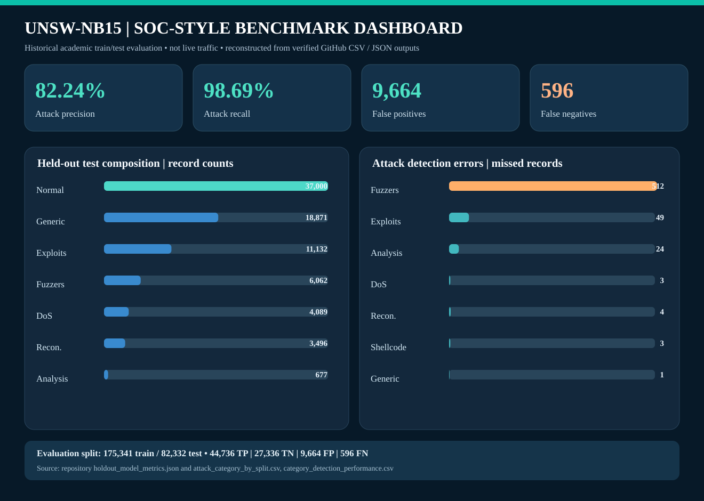

# UNSW-NB15 Network Intrusion & SOC Analytics — Project 12

## Executive summary
Defensive SQL, Python and machine-learning analysis of the **UNSW-NB15 historical academic network intrusion benchmark**. **NOT real-time SOC monitoring**. No time trend, current threat claims, or deployment guarantee.

## Sources and provenance
- [UNSW-NB15 official research description](https://research.unsw.edu.au/projects/unsw-nb15-dataset)
- Dataset files required: `UNSW_NB15_training-set.csv`, `UNSW_NB15_testing-set.csv`.
- Official training/testing sizes: 175,341 / 82,332 rows (observed).
- The academic data represents research traffic, including simulated attack behaviors; avoid treating proportions as real-world incident prevalence.
- Do not redistribute source records without confirming licensing and permitted reuse.

## Methodology
1. Import canonical train/test partitions; validate headers and labels.
2. Audit missing fields, duplicates and attack categories.
3. Run SQLite segmentation by protocol, service and connection state; reconcile counts.
4. Train a baseline HistGradientBoostingClassifier with train-only imputation/encoding.
5. Score official untouched test partition; inspect category detection errors.
6. Generate a reproducible PNG dashboard and evidence-based recommendations.

## Held-out benchmark metrics
| Measure | Value |
|---|---:|
| Training rows | 175,341 |
| Testing rows | 82,332 |
| Attack precision | 0.8224 |
| Attack recall | 0.9869 |
| Attack F1 | 0.8971 |
| Accuracy | 0.8754 |
| False positives | 9,664 |
| False negatives | 596 |

## SOC-style static dashboard
Reconstructed SVG dashboard from published repository outputs; the original Colab-generated PNG was not available in this repository. Values are drawn from `holdout_model_metrics.json`, `attack_category_by_split.csv`, and `category_detection_performance.csv`.

## Recommendations
1. **Report evaluation honestly** — Test attack recall 98.7%; 596 false negatives. Action: Prioritize recall and review missed attack categories alongside precision. KPI: Track held-out precision, recall, F1 and miss rate.
2. **Investigate false alerts** — 9,664 false positives; FPR 26.1%. Action: Examine normal traffic incorrectly flagged in a controlled validation sample. KPI: Monitor false-positive rate and analyst-review burden.
3. **Investigate category-level blind spots** — Per-category held-out errors exported. Action: Review underperforming categories and imbalance before choosing model changes. KPI: Report attack-category recall and sample support.
4. **Preserve leakage-safe evaluation** — Official training and held-out testing partitions are separate. Action: Fit encoders, imputers and model only on training partition. KPI: No preprocessing fit on test; repeatable metrics.
5. **Strengthen source data validation** — 175,341 train rows; 82,332 test rows. Action: Monitor missingness, duplicates, schema and numeric conversion failures. KPI: Schema passes and audit CSVs reconcile.
6. **Use SQL segmentation for triage** — 10 categories including Normal in test. Action: Review patterns by service, protocol, state and category without inventing attack chronology. KPI: SQL groups reconcile to total test records.
7. **Validate on relevant modern data before operational use** — UNSW-NB15 is a historical research benchmark. Action: Obtain authorized recent datasets and evaluate drift, deployment risks and privacy. KPI: Never claim live SOC capability without separate validation.

## Project outputs
- `data_quality_audit.csv`: train/test data integrity
- `outputs/attack_category_by_split.csv`: category distributions
- `outputs/protocol_breakdown.csv`, `service_breakdown.csv`, `connection_state_breakdown.csv`: reconciled SQL
- `outputs/holdout_model_metrics.json`: benchmark confusion matrix and model metrics
- `outputs/category_detection_performance.csv`: category-specific holdout model gaps
- `outputs/recommendations.csv`: seven actionable recommendations

## Limitations
- No verified wall-clock alert timestamps, endpoint identities, organizations or geographic incidents in the canonical training/testing features.
- These benchmark model metrics do not establish production reliability or real SOC incident-detection effectiveness.
- Only use data and cloud environments with legitimate authorization.

## Reproduce on Google Colab
Open `Project_12_UNSW_NB15_SOC_Analytics_AutoDownload.ipynb`; run all eight code cells; the notebook tries to download the split CSV files automatically, and requests manual upload if retrieval fails. The last cell downloads a ZIP with the deliverables. Upload the saved notebook and extracted project files (not just the ZIP) to GitHub.
